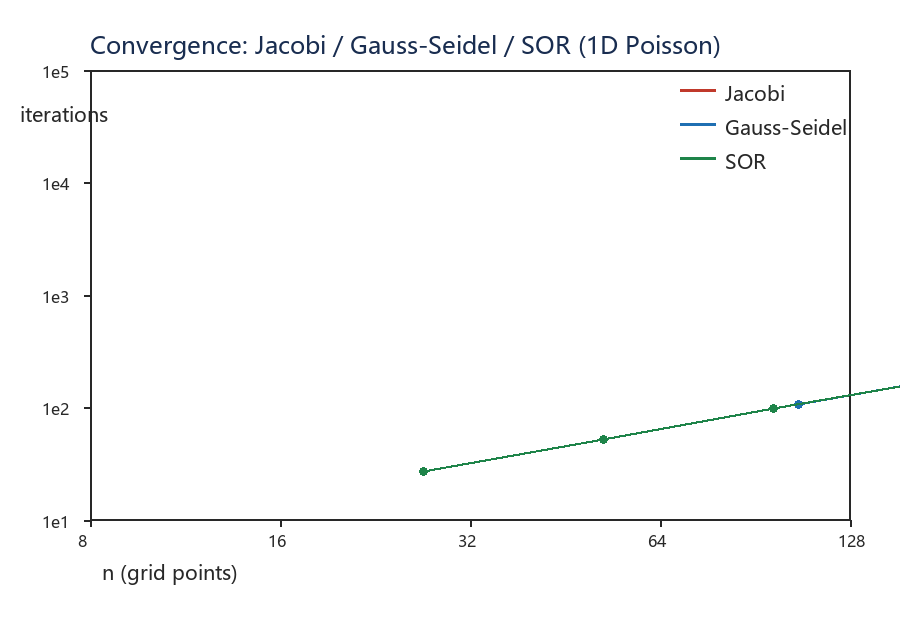

# Day 2：数值线性代数——条件数、稳定性、LU 与迭代法

> 日期：2026-11-04
> 承接 Day 1：椭圆问题（Poisson）离散后就是一个线性系统 $Au=b$。
> 今日目标：理解"病态/良态"与"稳定/不稳定"，掌握直接法（LU）与迭代法（Jacobi/Gauss-Seidel/SOR）的收敛行为。

## 0. 为什么今天学这个

Day 1 的椭圆问题 $\nabla^2 u=f$ 离散后变成大型稀疏线性系统 $Au=b$。在 CFD/FEM/光学模拟里，**解这个线性系统通常是最贵的一步**。今天解决三件事：

1. 浮点误差会放大多少（条件数）。
2. 直接法 LU 什么时候好用、什么时候崩。
3. 经典迭代法怎么收敛、为什么慢、怎么加速。

## 1. 浮点误差与机器精度

双精度浮点（IEEE 754 double）的机器精度：

$$
\epsilon_{\text{mach}}\approx 2.22\times 10^{-16}.
$$

这是"相邻两个浮点数的相对间距"。任何一次算术运算都会引入约 $\epsilon_{\text{mach}}$ 量级的**舍入误差**。区分的两个概念：

- **前向误差**：计算解与真解的差。
- **后向误差**：把计算解当成"某个微扰问题"的精确解时，微扰有多大。

数值线性代数的黄金标准是**后向稳定**：算法产生的结果是"一个微扰问题 $A+\delta A$ 的精确解"，其中 $\|\delta A\|\le c\,\epsilon_{\text{mach}}\|A\|$。高斯消元/LU 就是后向稳定的。

## 2. 条件数

问题的**条件数**衡量"输入扰动被放大多少"：

$$
\kappa(A)=\|A\|\,\|A^{-1}\|.
$$

对扰动 $b\to b+\delta b$，解满足

$$
\frac{\|\delta x\|}{\|x\|}\le \kappa(A)\,\frac{\|\delta b\|}{\|b\|}.
$$

$\kappa$ 大 = **病态**，小 = **良态**。对对称矩阵取 2-范数：

$$
\kappa_2(A)=\frac{|\lambda_{\max}|}{|\lambda_{\min}|}.
$$

### 关键例子：离散 Laplacian

1D Poisson 的三对角矩阵（对角 2、次对角 -1）条件数约为

$$
\kappa_2 \approx \frac{4n^2}{\pi^2}\sim O(n^2)=O(h^{-2}).
$$

**结论**：网格加密一倍，条件数约变 4 倍。这就是"网格越细，线性系统越难解"的根源，也是迭代法在高分辨率下变慢的根本原因。

注意：病态是**问题本身**的性质，不是算法的错；再稳定的算法也救不了病态问题。这也是为什么直接法（后向稳定）在病态下仍可靠，而迭代法要看收敛速度。

## 3. 稳定性

- **问题的良态/病态**：条件数小/大。
- **算法的稳定/不稳定**：误差是否被指数放大。

LU 分解（含部分主元）是后向稳定的；显式求 $A^{-1}$ 数值上既不稳定又昂贵，应该避免。

## 4. 直接法：LU 分解

LU 把 $A$ 分解为下三角 $L$ 与上三角 $U$，然后两次回代。对称正定时退化为 Cholesky $A=LL^T$（省一半）。

### 1D：Thomas 算法（追赶法）

1D Poisson 是三对角矩阵，LU 不产生 fill-in，代价 $O(n)$。这是直接法的理想情形。

### 2D/3D：fill-in 让直接法变贵

二维以上，带状结构的带宽随 $n$ 增长，LU 分解会在带内产生大量 fill-in，代价从 $O(n)$ 涨到 $O(n^{3})$ 甚至 $O(n^2)$ 量级。所以工程上大问题用**迭代法**（配合多重网格、预条件 Krylov）。

## 5. 迭代法：Jacobi / Gauss-Seidel / SOR

### 5.1 分裂法统一框架

把 $A$ 拆成 $A=M-N$，迭代

$$
M x^{(k+1)}=N x^{(k)}+b.
$$

收敛的充要条件是迭代矩阵 $G=M^{-1}N$ 的**谱半径** $\rho(G)<1$，且 $\rho$ 越小收敛越快。

| 方法 | $M$ | 迭代矩阵 $G$ |
| --- | --- | --- |
| Jacobi | 对角 $D$ | $D^{-1}(L+U)$ |
| Gauss-Seidel | 下三角 $D+L$ | $(D+L)^{-1}U$ |
| SOR | $\tfrac1\omega D+L$ | 含松弛因子 $\omega$ |

### 5.2 三种方法的更新公式（1D Poisson）

1D Poisson 离散后内点满足 $2u_i-u_{i-1}-u_{i+1}=b_i$，三种方法：

$$
\text{Jacobi:}\quad u_i^{(k+1)}=\tfrac12\Big(u_{i-1}^{(k)}+u_{i+1}^{(k)}+b_i\Big),
$$

$$
\text{Gauss-Seidel:}\quad u_i^{(k+1)}=\tfrac12\Big(u_{i-1}^{(k+1)}+u_{i+1}^{(k)}+b_i\Big),
$$

$$
\text{SOR:}\quad u_i^{(k+1)}=u_i^{(k)}+\omega\Big[\tfrac12\big(u_{i-1}^{(k+1)}+u_{i+1}^{(k)}+b_i\big)-u_i^{(k)}\Big].
$$

Jacobi 用上一轮的全部值；Gauss-Seidel 一旦算出新值立刻用（就地更新）；SOR 在 GS 基础上加松弛因子 $\omega$（$1<\omega<2$ 为超松弛）。

### 5.3 谱半径决定收敛次数

对 1D Poisson，三种方法谱半径（$h=1/n$）：

$$
\rho_J=\cos(\pi h)\approx 1-\frac{\pi^2 h^2}{2},
$$

$$
\rho_{GS}=\cos^2(\pi h)=\rho_J^2,
$$

$$
\rho_{SOR}\approx 1-2\pi h\quad(\text{取最优 }\omega).
$$

要压到容差 $\epsilon$，迭代次数 $k$ 满足 $\rho^k\le\epsilon$，即 $k\approx\frac{\ln\epsilon}{\ln\rho}$。小 $h$ 时 $\ln\rho\approx-(\text{量级})$，于是：

| 方法 | 迭代次数量级 |
| --- | --- |
| Jacobi | $O(n^2)$ |
| Gauss-Seidel | $O(n^2)/2$（比 Jacobi 快一倍） |
| SOR（最优 $\omega$） | $O(n)$ |

最优 $\omega$ 为 $\omega_{\text{opt}}=\frac{2}{1+\sqrt{1-\rho_J^2}}=\frac{2}{1+\sin(\pi h)}$。

### 5.4 为什么还是慢：低频误差

Jacobi/GS 对**高频**误差平滑得很快，但对**低频**误差收敛极慢——这是谱半径接近 1 的直观来源。这也预告了后面的多重网格：先用平滑器干掉高频，再在粗网格上处理低频，才能把收敛次数降到 $O(1)$ 量级。

## 6. 动手实验与结果

方程 $-u''=\pi^2\sin(\pi x)$，$u(0)=u(1)=0$，真解 $u=\sin(\pi x)$。三点中心差分，容差 $10^{-8}$。

真实迭代次数（随网格加密）：

| $n$ | Jacobi | Gauss-Seidel | SOR | SOR 误差 |
| --- | --- | --- | --- | --- |
| 8 | 210 | 106 | 27 | $1.30\times10^{-2}$ |
| 16 | 782 | 392 | 52 | $3.22\times10^{-3}$ |
| 32 | 2855 | 1429 | 97 | $8.03\times10^{-4}$ |
| 64 | 10282 | 5142 | 178 | $2.00\times10^{-4}$ |
| 128 | 36538 | 18270 | 329 | $4.83\times10^{-5}$ |

看三点：

1. **Jacobi 约 $n^2$**：$n$ 翻倍，迭代次数约 4 倍。
2. **GS 约 Jacobi 的一半**：印证 $\rho_{GS}=\rho_J^2$（快一倍）。
3. **SOR 约 $n$**：$n$ 翻倍，迭代次数约 2 倍，且误差随 $h^2$ 下降（二阶收敛），说明实现正确。

配套代码：[day2_poisson_iterative.py](day2_poisson_iterative.py)。

## 7. 今日关键结论速记

- 条件数 $\kappa=\|A\|\|A^{-1}\|$ 是问题的属性，离散 Laplacian 的 $\kappa\sim O(n^2)$。
- 后向稳定是直接法（LU）的可靠来源；显式求逆矩阵既不稳又贵。
- 1D 三对角用 Thomas 算法 $O(n)$；高维直接法 fill-in 贵，转向迭代法。
- 分裂法收敛看谱半径 $\rho(G)<1$；$\rho_{GS}=\rho_J^2$，SOR 最优时 $\rho_{SOR}\sim1-2\pi h$。
- 迭代次数：Jacobi $O(n^2)$、GS $O(n^2)/2$、SOR $O(n)$；低频误差慢是共同瓶颈，引向多重网格。

## 8. 今日自测清单

1. 写出 1D 离散 Laplacian 矩阵，并手推其条件数 $O(n^2)$。
2. 说明"后向稳定"和"条件数"分别回答什么问题。
3. 从分裂法框架推出 Jacobi、Gauss-Seidel、SOR 的迭代矩阵 $G$。
4. 解释为什么 $\rho_{GS}=\rho_J^2$ 意味着 GS 比 Jacobi 快一倍。
5. 自己跑一遍配套代码，改容差或网格，验证迭代次数量级是否与理论一致。
